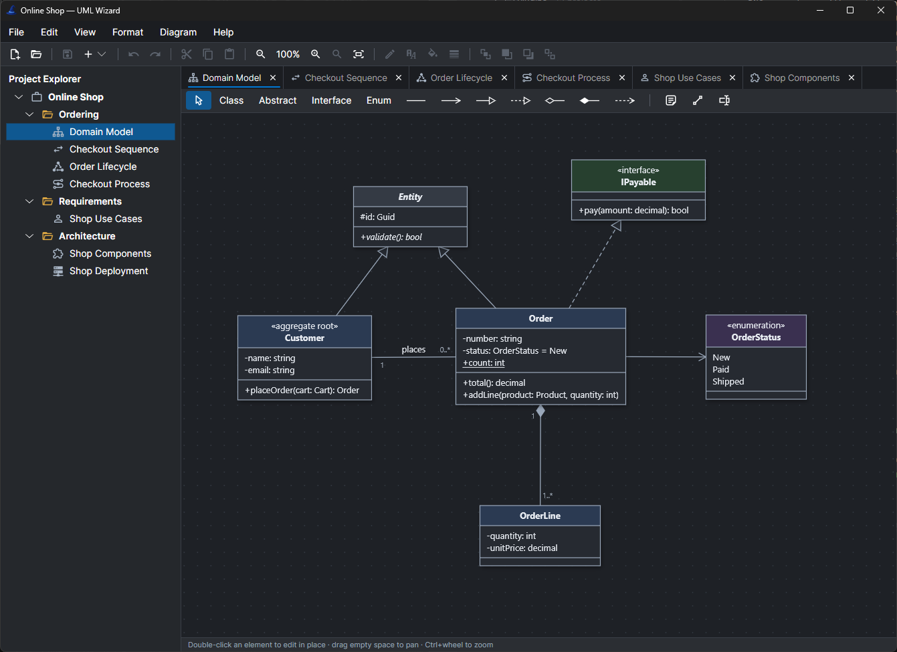

# UML Wizard



A UML designer built with **Avalonia UI** (application shell) and **SkiaSharp** (diagram rendering). It runs on
Windows, macOS and Linux.

- **Seven diagram types:** class, sequence, state machine, activity, use case, component and deployment diagrams,
  organised in projects and folders.
- **Editing:** in-place editing in UML notation, undo/redo, clipboard, notes and text boxes, fonts, colours and line
  styles, light and dark themes, and **Arrange Diagram** to lay a diagram out automatically.
- **Code generation** from class diagrams to C#, Java, Kotlin, TypeScript, Ruby or C++.
- **Code import:** a class diagram from a folder of C#, C++, Java, Kotlin, Ruby or TypeScript code.
- **OpenAPI** import and export of class diagrams, and **PlantUML** import and export of every diagram type.
- **PNG export**, with a white or transparent background.
- **AI assistant** (optional): Diagram → Create with AI draws a diagram from a description, and View → AI Chat talks
  about the active diagram and proposes changes to it, of any type, which you apply as one undoable step. With Claude, an
  OpenAI-compatible service or a local model (Ollama, LM Studio); see the [design](docs/design/ai-assistant.md).
- **Preferences** (File → Preferences, Ctrl+,): projects folder, display language, theme, the font of the user
  interface, and the default fills, border and thickness of the shapes of each diagram type.
- **Plug-ins:** every code generation and code import language is a plug-in DLL, so more can be added.

## Documentation

- **[User Manual](docs/help/user-manual-en.html):** how to use the application. It is installed with it and opens from
  **Help → User Manual** (F1).
- **[Learn UML](docs/help/learn-uml-en.html):** learn the basics of UML, a modeling language for software systems.
- **How-to pages** in [`docs/help`](docs/help/), [OpenAPI](docs/help/openapi-how-to-en.html), [PlantUML](docs/help/plantuml-how-to-en.html) and [generating code](docs/help/generating-code-how-to-en.html).
- **Design documents** in [`docs/design`](docs/design/): [Architecture](docs/design/architecture.md),
  [File format](docs/design/file-format.md) and [AI assistant](docs/design/ai-assistant.md).
- **Plug-in guides:** [writing a code generator plug-in](docs/plugins/writing-a-codegeneration-plugin.md) and
  [writing a code import plug-in](docs/plugins/writing-a-codeimport-plugin.md).

## Build and run

Requires the .NET 9 SDK (or later).

```bash
dotnet build
dotnet run --project src/UmlWizard.App -- samples/OnlineShop/OnlineShop.umlwiz
dotnet test
```

A project file passed on the command line is opened at start-up.

On Linux, SkiaSharp needs fontconfig and Avalonia the X11 libraries; minimal installs may need `libfontconfig1`,
`libx11-6`, `libice6` and `libsm6`. Wayland sessions run through XWayland.

## Samples

**OnlineShop** (`samples/OnlineShop/OnlineShop.umlwiz`) shows every diagram type on one subject:

| Folder | Diagram | Type | Shows |
|---|---|---|---|
| Ordering | Domain Model | Class | Classes, an abstract class, an interface and an enumeration; inheritance, realization, association and composition with multiplicities |
| Ordering | Checkout Sequence | Sequence | An actor and object lifelines; synchronous calls, replies and an asynchronous message |
| Ordering | Order Lifecycle | State machine | Initial and final states, a choice, guards and effects, a self-transition, a note attached to a state |
| Ordering | Checkout Process | Activity | Decision and merge, fork and join, guards |
| Requirements | Shop Use Cases | Use case | Actors, a system boundary, «include», «extend», actor generalization |
| Architecture | Shop Components | Component | Components, provided interfaces (realizations), dependencies |
| Architecture | Shop Deployment | Deployment | Devices and a node with nested execution environments and artifacts, communication paths labelled with protocols, «manifest», a note attached to an environment |

**GangOfFour** (`samples/GangOfFour/GangOfFour.umlwiz`) has one class diagram per design pattern of *Design
Patterns* (Gamma, Helm, Johnson, Vlissides), each with the pattern's intent as its description.

## UML support

UML Wizard draws a subset of **UML 2.x** (UML 2.5.1) notation; it does not claim full conformance to the OMG
specification and has no XMI import or export. The [User Manual](docs/help/user-manual-en.html#diagram-types) lists, per
diagram type, the constructs that are supported and those that are not.

## Licence

UML Wizard is licensed under the [Apache License 2.0](LICENSE); its copyright notice is in [NOTICE](NOTICE). The build
copies both next to the executable, as `LICENSE.txt` and `NOTICE.txt`, and **Help → About** names the licence.

## Third-party notices

`THIRD-PARTY-NOTICES.txt` lists every third-party component the application ships with — Material Design Icons,
Avalonia, SkiaSharp, the Inter font and the rest — with its version, source and full license text. The build copies
it next to the executable, and **Help → About** acknowledges the main components and opens the file.

When you add or upgrade a NuGet package, add or update its entry: a test compares the file with the application's
dependency manifest (`UmlWizard.deps.json`) and fails when a shipped package or its version is missing.
